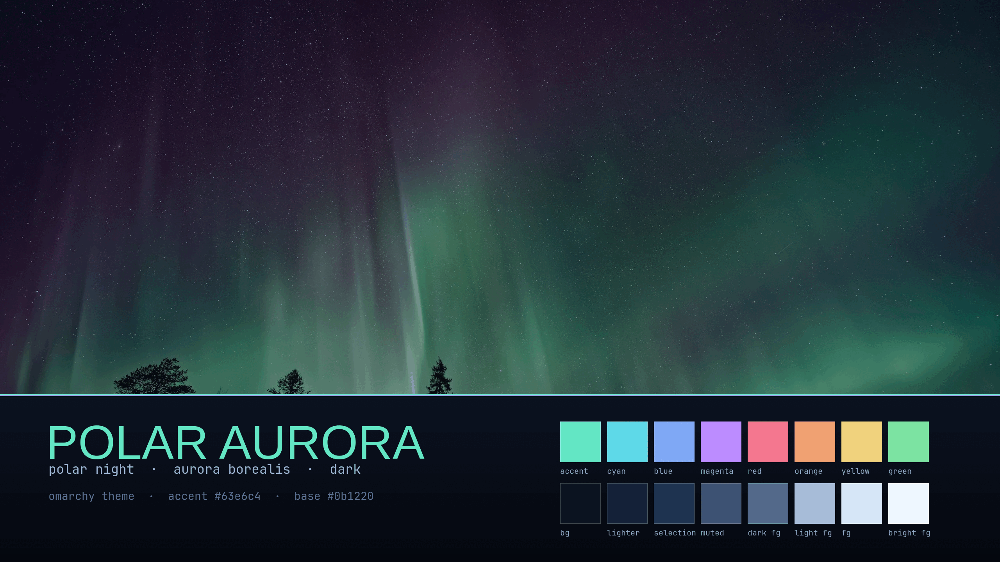

<div align="center">



# Polar Aurora

English · [Русский](README.ru.md)

**A dark theme for Omarchy: polar night, aurora borealis, and a mint-teal accent that stays out of the way.**

[](LICENSE)
[](#install)

</div>

---

## Install

```bash
omarchy theme install https://github.com/valerkaaa/omarchy-theme-polar-aurora
omarchy theme set "Polar Aurora"
```

Or by hand:

```bash
git clone https://github.com/valerkaaa/omarchy-theme-polar-aurora \
  ~/.config/omarchy/themes/polar-aurora
omarchy theme set "Polar Aurora"
```

The theme ships no `*.lua` and no terminal configs, so nothing is dropped on
install — Omarchy generates those from `colors.toml`.

## What you get

- **Five backgrounds** in `backgrounds/` — cycle them with `omarchy theme bg next`:
  aurora over pines, violet drift, teal horizon, frozen lake, snowbound cabin.
- **A gradient window border** — mint to violet at 45°, dim slate when inactive.
- **A theme for everything Omarchy themes**: Hyprland, the bar and its panels,
  the launcher, Alacritty, Foot, Kitty, Ghostty, btop, Helix, Neovim, VS Code,
  Chromium, fcitx5, Claude, Hermes.
- **A lock screen and a preview** (`unlock.png`, `preview.png`,
  `preview-unlock.png`) so it reads correctly in the theme picker.

## Palette

| Role | Colour | |
|---|---|---|
| accent | `#63e6c4` | mint-teal, the aurora |
| accent, second | `#bd8cff` | violet, the other band |
| background | `#0b1220` | polar night |
| darker background | `#04070e` | |
| foreground | `#d6e6f7` | snow-lit text |
| selection | `#1e3350` | |
| muted | `#3d5273` | |
| red / yellow / green / cyan / blue / magenta | `#f4778f` `#f0d27d` `#7ce3a2` `#5ed9e8` `#7fa8f5` `#bd8cff` | |

The full set, including the bright variants, is in
[`colors.toml`](colors.toml).

## Notes

- The icon theme is `Yaru-prussiangreen-dark`, which ships with Omarchy.
- The keyboard backlight colour is `#63e6c4`, for keyboards that take one.
- Everything is generated from `colors.toml`; edit that file and re-apply the
  theme to change the whole desktop at once.

## License

MIT — see [LICENSE](LICENSE). A theme for Omarchy, not affiliated with it.
