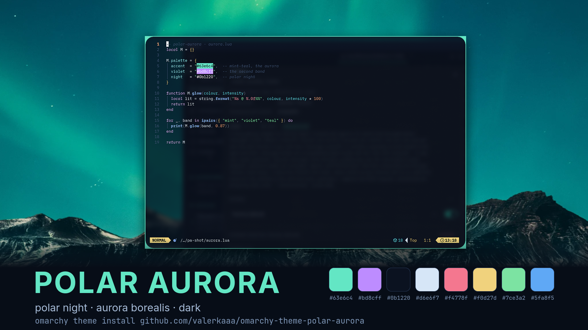
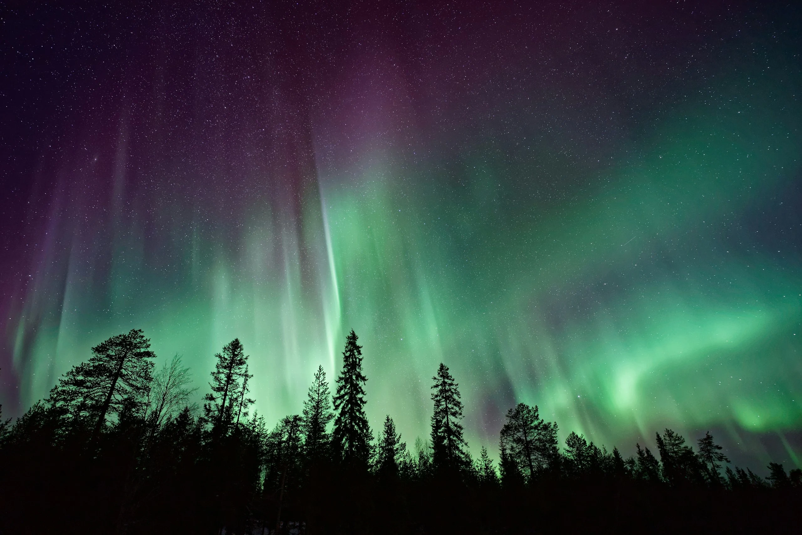
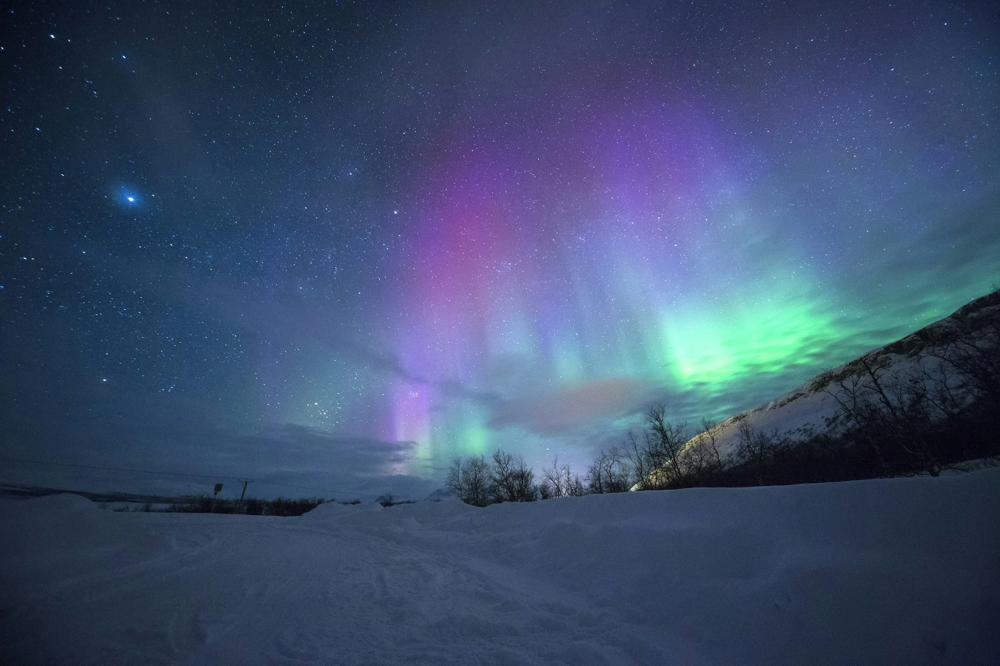
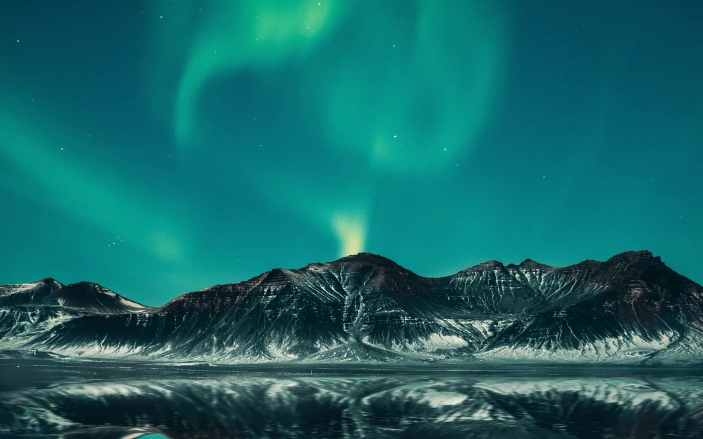
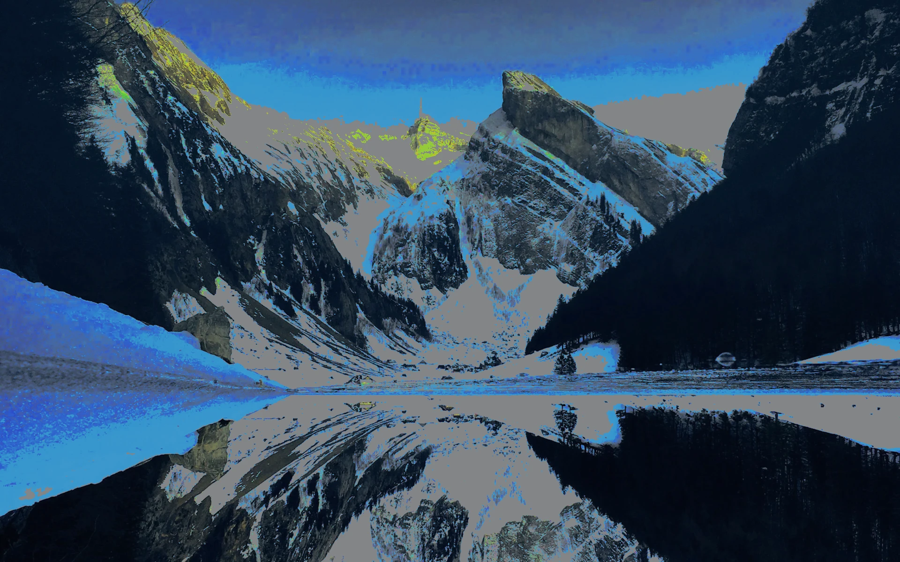

<div align="center">



# Polar Aurora

[English](README.md) · **Русский**

**Тёмная тема для Omarchy: полярная ночь, северное сияние и мятно-бирюзовый акцент, который не мешает.**

[](LICENSE)
[](#установка)

</div>

---

## Установка

```bash
omarchy theme install https://github.com/valerkaaa/omarchy-theme-polar-aurora
omarchy theme set "Polar Aurora"
```

Или руками:

```bash
git clone https://github.com/valerkaaa/omarchy-theme-polar-aurora \
  ~/.config/omarchy/themes/polar-aurora
omarchy theme set "Polar Aurora"
```

В теме нет ни одного `*.lua` и нет конфигов терминалов, поэтому при установке
ничего не отбрасывается — Omarchy генерирует их из `colors.toml`.

## Что внутри

- **Четыре обоев** в `backgrounds/` — переключаются через
  `omarchy theme bg next`: три полярные ночи и один кадр в синий час, для тех
  случаев, когда хочется светлее.
- **Градиентная рамка окон** — от мятного к фиолетовому под 45°, приглушённый
  сланец в неактивном окне.
- **Тема для всего, что Omarchy умеет темизировать**: Hyprland, бар и его панели,
  лаунчер, Alacritty, Foot, Kitty, Ghostty, btop, Helix, Neovim, VS Code,
  Chromium, fcitx5, Claude, Hermes.
- **Экран блокировки и превью** (`unlock.png`, `preview.png`,
  `preview-unlock.png`), чтобы тема правильно выглядела в выборе тем.

## Обои

<table>
<tr>
<td align="center"><br><sub>aurora over pines</sub></td>
<td align="center"><br><sub>violet drift</sub></td>
</tr>
<tr>
<td align="center"><br><sub>teal horizon</sub></td>
<td align="center"><br><sub>polar twilight</sub></td>
</tr>
</table>

## Палитра

| Роль | Цвет | |
|---|---|---|
| акцент | `#63e6c4` | мятно-бирюзовый, сияние |
| второй акцент | `#bd8cff` | фиолетовый, вторая полоса |
| фон | `#0b1220` | полярная ночь |
| фон темнее | `#04070e` | |
| текст | `#d6e6f7` | подсвеченный снегом |
| выделение | `#28426a` | |
| приглушённый | `#3d5273` | |
| красный / жёлтый / зелёный / циан / синий / маджента | `#f4778f` `#f0d27d` `#7ce3a2` `#5ed9e8` `#7fa8f5` `#bd8cff` | |

Полный набор, включая яркие варианты, — в [`colors.toml`](colors.toml).

## Заметки

- Тема иконок — `Yaru-prussiangreen-dark`, идёт вместе с Omarchy.
- Подсветка клавиатуры — `#63e6c4`, для клавиатур, которые это умеют.
- Всё генерируется из `colors.toml`: правь его и переприменяй тему, чтобы
  поменять весь рабочий стол разом.

## Лицензия

MIT — см. [LICENSE](LICENSE). Тема для Omarchy, с Omarchy не связана.
